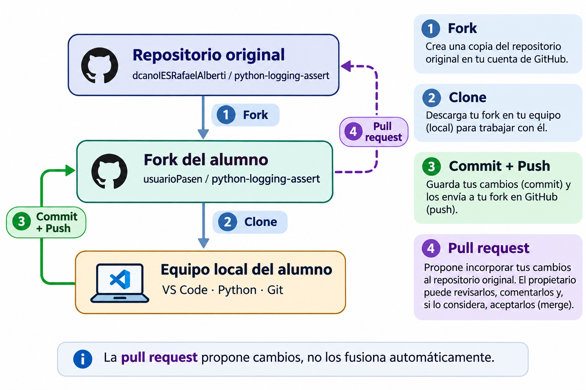

# Práctica guiada — Logging, assert y gestión de excepciones en Python

## 1. Introducción

Vamos a desarrollar una pequeña aplicación de **gestión de stock de una tienda** que permita:

- Registrar ventas de productos.
- Reponer unidades del inventario.
- Consultar el stock disponible.
- Controlar operaciones incorrectas mediante excepciones.
- Registrar información sobre el funcionamiento del programa utilizando `logging`.
- Comprobar condiciones internas mediante `assert`.

El objetivo principal es comprender cómo podemos obtener información sobre lo que sucede durante la ejecución de una aplicación, tanto cuando funciona correctamente como cuando se produce algún problema.

Partiremos de un programa sencillo y lo iremos modificando durante la clase.

## 2. Los cinco niveles de logging

El módulo `logging` de Python permite registrar mensajes que describen lo que ocurre durante la ejecución de un programa.

Estos mensajes se clasifican según su importancia.

| Nivel | Valor | Utilidad |
|---|---:|---|
| `DEBUG` | 10 | Información detallada para depurar el programa. |
| `INFO` | 20 | Información sobre operaciones realizadas correctamente. |
| `WARNING` | 30 | Situaciones que requieren atención, aunque el programa puede continuar. |
| `ERROR` | 40 | Operaciones que han fallado. |
| `CRITICAL` | 50 | Problemas graves que pueden impedir el funcionamiento de la aplicación. |

En nuestra aplicación utilizaremos estos niveles de la siguiente manera:

- `DEBUG`: registrar los datos de una operación antes de realizarla.
- `INFO`: registrar ventas, reposiciones y consultas realizadas.
- `WARNING`: avisar cuando quedan pocas unidades en el inventario.
- `ERROR`: registrar una venta rechazada por falta de stock.
- `CRITICAL`: detectar un inventario inicial inválido que impide iniciar la aplicación.

**Importante:** cuando configuramos un nivel de logging, se registran los mensajes de ese nivel y de todos los niveles superiores.

Por ejemplo, si configuramos `WARNING`, se registrarán los mensajes `WARNING`, `ERROR` y `CRITICAL`, pero no los mensajes `DEBUG` ni `INFO`.

---

## 3. Preparación del entorno de trabajo

En esta práctica utilizaremos un repositorio público de GitHub que contiene el código inicial de la aplicación.

En lugar de trabajar directamente sobre el repositorio original, cada alumno creará su propia copia mediante un **fork**.

Un *fork* permite crear una copia de un repositorio en nuestra cuenta de GitHub para trabajar de manera independiente.



**Pasos**

1. Accede al repositorio facilitado por el profesor.
2. Pulsa **Fork → Create a new fork** y selecciona tu cuenta personal de GitHub.
3. Clona tu fork en tu equipo utilizando `git clone`.
4. Abre el proyecto en Visual Studio Code.
5. Sigue las modificaciones que realizaremos durante la clase.

**¿Cómo guardar nuestros cambios en GitHub?**

Los cambios realizados en nuestro equipo pueden guardarse en el repositorio remoto mediante las operaciones habituales de Git:

- `git add`: prepara los archivos modificados.
- `git commit`: registra los cambios en el repositorio local.
- `git push`: envía los commits a nuestro fork de GitHub.

**¿Y si queremos contribuir al repositorio original?**

Podemos crear una **pull request (PR)** desde nuestro fork.

Una pull request es una propuesta para incorporar nuestros cambios a otro repositorio. Su propietario puede revisar las modificaciones, comentarlas, solicitar correcciones y, si lo considera oportuno, aceptarlas mediante una fusión (*merge*).

En esta práctica no es necesario crear ninguna pull request. Nuestro trabajo se realizará en el fork personal y en el equipo local.

---

## 4. Código inicial de la aplicación

En la carpeta `src` tenéis un módulo llamado `tienda.py` con una versión inicial.

El programa contiene las funciones necesarias para gestionar el inventario, pero todavía tenemos que completar el bucle del menú y configurar el sistema de registros.

**Construcción del bucle principal**

Vamos a completar juntos la función `main()`.

El bucle debe:

1. Mostrar el menú mediante `mostrar_menu()`.
2. Solicitar la opción mediante `pedir_opcion()`.
3. Finalizar cuando se seleccione `"0"`.
4. Ejecutar `procesar_opcion()` para las opciones válidas (`"1"`, `"2"` y `"3"`), mostrando un mensaje de error para cualquier otra opción distinta de `"0"`.
5. Actualizar el stock con el valor devuelto por la función.
6. Capturar las excepciones `ValueError` y mostrar un mensaje al usuario sin finalizar la aplicación.

Para ello utilizaremos un bucle `while`, una estructura `if`, y un bloque `try-except`.

Una vez completado, ejecuta el programa y prueba ventas, reposiciones, consultas, cantidades incorrectas y opciones de menú no válidas.

---

## 5. Primera configuración: logging básico en la terminal

Añade la siguiente configuración al comienzo de `main()`, antes de registrar cualquier mensaje:

```python
logging.basicConfig(
    level=logging.DEBUG,
    format="%(levelname)s - %(message)s"
)
```

Ejecuta nuevamente el programa:

```bash
python ./src/tienda.py
```

Observa los mensajes que aparecen durante las operaciones.

### 5.1. ¿Qué significa level?

El parámetro `level` establece el nivel mínimo de los mensajes que se registrarán.

Por ejemplo:

```python
level=logging.DEBUG
```

Permite registrar mensajes de los cinco niveles.

En cambio:

```python
level=logging.WARNING
```

Permite registrar únicamente mensajes `WARNING`, `ERROR` y `CRITICAL`.

Cambia el nivel y ejecuta nuevamente el programa para comprobar las diferencias.

### 5.2. ¿Qué significa format?

El parámetro `format` establece cómo se presenta cada mensaje.

En nuestro ejemplo:

```python
format="%(levelname)s - %(message)s"
```

Se utilizan dos campos:

- `%(levelname)s`: nombre del nivel del mensaje.
- `%(message)s`: texto del mensaje.

Por ejemplo:

```python
logging.warning("Quedan pocas unidades")
```

Produce:

```text
WARNING - Quedan pocas unidades
```

### 5.3. ¿Por qué se utiliza %(levelname)s?

Esta sintaxis procede del formato tradicional de cadenas de Python.

En la expresión `%(levelname)s`:

- `%` introduce un marcador de sustitución.
- `(levelname)` identifica el campo cuyo valor queremos mostrar.
- `s` indica que el valor se representará como una cadena de texto.

Los paréntesis permiten identificar el nombre del campo. No son una llamada a una función.

Podemos utilizar un único campo:

```python
format="%(levelname)s"
```

En ese caso aparecerá únicamente el nivel:

```text
WARNING
```

También podemos combinar varios campos:

```python
format="%(levelname)s - %(message)s"
```

No es necesario utilizar todos los campos disponibles, únicamente aquellos que nos interesen.

### 5.4. Campos habituales de logging

| Campo | Información |
|---|---|
| `%(levelname)s` | Nombre del nivel del mensaje. |
| `%(message)s` | Texto del mensaje. |
| `%(asctime)s` | Fecha y hora del registro. |
| `%(name)s` | Nombre del logger. |
| `%(filename)s` | Nombre del archivo Python. |
| `%(funcName)s` | Nombre de la función. |
| `%(lineno)d` | Número de línea desde la que se registra el mensaje. |

Observa que `%(lineno)d` termina en `d`, porque representa un número entero.

Prueba ahora este formato:

```python
format="%(asctime)s - %(levelname)s - %(funcName)s:%(lineno)d - %(message)s"
```

Ejecuta el programa y observa la información adicional que aparece en cada registro.

### 5.5. ¿Dónde se muestran los mensajes?

Por defecto, `logging.basicConfig()` envía los mensajes a la **salida estándar de errores** (`sys.stderr`), mientras que `print()` utiliza la **salida estándar** (`sys.stdout`).

Aunque son dos canales diferentes, ambos muestran sus mensajes en la misma terminal.

Esto no significa que todos los mensajes de `logging` sean errores: también se muestran los niveles `DEBUG`, `INFO` y `WARNING`, según la configuración establecida.

A continuación, vamos a modificar la configuración de `logging` para que los mensajes se guarden en un **archivo de registro**, en lugar de mostrarse en la terminal.

---

## 6. Segunda configuración: guardar los registros en un archivo

En una aplicación real puede resultar útil conservar los registros para consultarlos posteriormente.

Sustituye la configuración anterior por:

```python
logging.basicConfig(
    level=logging.DEBUG,
    format="%(asctime)s - %(levelname)s - %(message)s",
    filename="tienda.log",
    filemode="w",
    encoding="utf-8"
)
```

Ejecuta nuevamente el programa.

Observa que los mensajes de logging ya no aparecen en la terminal, sino en el archivo `tienda.log`.

Los mensajes generados mediante `print()` continúan apareciendo en pantalla.

### 6.1. Parámetros nuevos

**`filename`**

Indica el archivo donde se almacenarán los registros.

**`filemode`**

Establece cómo se abre el archivo:

- `"w"`: sobrescribe el contenido anterior.
- `"a"`: añade los nuevos registros al final del archivo.

**`encoding`**

Establece la codificación utilizada para guardar el texto.

En este caso utilizamos UTF-8.

### 6.2. ¿Qué ventajas tiene guardar los registros en un archivo?

Hasta ahora, los mensajes de `logging` se mostraban en la terminal junto con la salida habitual del programa.

Al utilizar el parámetro `filename`, los mensajes se guardan directamente en un archivo de registro, lo que permite:

- **Conservar los registros** para consultarlos posteriormente.
- **Mantener la terminal más limpia**, mostrando únicamente los mensajes destinados al usuario.
- **Analizar errores y operaciones** incluso después de finalizar el programa.

**Comprobación:** cambia `filemode="w"` por `filemode="a"` y ejecuta el programa dos veces. Abre `tienda.log` y comprueba que se conservan los registros de ambas ejecuciones.

---

## 7. Tercera configuración: registrar en archivo y terminal

Ahora queremos conseguir lo siguiente:

- Registrar todos los mensajes desde `DEBUG` en el archivo `tienda.log`.
- Mostrar únicamente los mensajes desde `ERROR` en la terminal.

Para ello utilizaremos dos **handlers**, uno para cada destino.

Un handler es un objeto que se encarga de enviar los mensajes de logging a un destino determinado.

Cada handler puede tener su propio nivel y formato.

### 7.1. Configuración con dos handlers

Añade la importación de `sys` al comienzo del archivo:

```python
import sys
```

Sustituye la configuración anterior de `logging.basicConfig()` por:

```python
formato = logging.Formatter(
    "%(asctime)s - %(levelname)s - %(message)s"
)

# Handler para el archivo
archivo = logging.FileHandler(
    "tienda.log",
    mode="a",
    encoding="utf-8"
)
archivo.setLevel(logging.DEBUG)
archivo.setFormatter(formato)

# Handler para la terminal
consola = logging.StreamHandler(sys.stderr)
consola.setLevel(logging.ERROR)
consola.setFormatter(formato)

# Logger principal
logger = logging.getLogger()
logger.setLevel(logging.DEBUG)
logger.addHandler(archivo)
logger.addHandler(consola)
```

### 7.2. ¿Cómo funciona?

**Logger principal**

```python
logger = logging.getLogger()
logger.setLevel(logging.DEBUG)
```

Obtenemos el logger principal y establecemos que procese mensajes desde `DEBUG`.

**Handler del archivo**

```python
archivo.setLevel(logging.DEBUG)
```

Permite guardar todos los mensajes desde `DEBUG` en `tienda.log`.

**Handler de la terminal**

```python
consola.setLevel(logging.ERROR)
```

Permite mostrar únicamente mensajes `ERROR` y `CRITICAL` en la terminal.

**Registro de los handlers**

```python
logger.addHandler(archivo)
logger.addHandler(consola)
```

Asociamos ambos destinos al logger principal.

### 7.3. Comprobación

Ejecuta el programa y realiza distintas operaciones.

Comprueba que:

- Las ventas correctas generan registros `INFO` en el archivo.
- Las operaciones muestran información `DEBUG` en el archivo.
- Cuando quedan pocas unidades, aparece un registro `WARNING` en el archivo.
- Si intentas vender más unidades de las disponibles, aparece un mensaje `ERROR` tanto en el archivo como en la terminal.

El programa seguirá mostrando los mensajes de `print()` en pantalla, independientemente del nivel de logging.

---

## 8. assert y gestión de excepciones

En nuestro programa hemos utilizado tres mecanismos diferentes: `if`, `raise` y `assert`.

También hemos utilizado `try-except` para capturar determinadas excepciones.

### 8.1. Validación mediante if y raise

En la función `vender()` encontramos:

```python
if cantidad <= 0:
    raise ValueError("La cantidad debe ser positiva")
```

Esta condición comprueba que el usuario haya introducido una cantidad válida.

Si no se cumple, se lanza una excepción `ValueError`.

En `main()`, el bloque `try-except` captura esa excepción para evitar que la aplicación termine inesperadamente.

### 8.2. Comprobación mediante assert

También tenemos:

```python
def comprobar_stock(stock: int) -> None:
    assert stock >= 0, "El stock no puede ser negativo"
```

La instrucción `assert` comprueba que una condición sea verdadera.

Si la condición es falsa, Python lanza una excepción `AssertionError`.

En este caso, estamos comprobando una condición interna del programa: después de una venta correctamente validada, el stock nunca debería ser negativo.

Por tanto, una aserción fallida puede ayudarnos a detectar un error de programación durante el desarrollo.

### 8.3. Provocar un error de programación

Para observar cómo funciona `assert`, vamos a introducir temporalmente un error.

En la función `vender()`, sustituye:

```python
stock -= cantidad
```

Por:

```python
stock -= cantidad * 2
```

Ejecuta el programa e intenta vender **6 unidades** cuando el stock inicial es **10**.

La comprobación previa permitirá la operación porque hay suficientes unidades para vender 6. Sin embargo, debido al error introducido, el programa intentará descontar 12 unidades.

La función `comprobar_stock()` detectará que el resultado es negativo y lanzará una excepción `AssertionError`.

**¿Qué ocurre durante la ejecución?**

El programa se detiene y Python muestra una traza de error (*traceback*) similar a esta:

```text
Traceback (most recent call last):
  ...
  File "tienda.py", line ..., in comprobar_stock
    assert stock >= 0, "El stock no puede ser negativo"
AssertionError: El stock no puede ser negativo
```

La traza nos permite identificar dónde se ha producido el problema:

- **`AssertionError`**: indica que una condición comprobada mediante `assert` no se ha cumplido.
- **`El stock no puede ser negativo`**: es el mensaje que hemos definido en la aserción.
- **`File`, `line` e `in comprobar_stock`**: permiten localizar el archivo, la línea y la función donde se ha detectado el error.

**¿Por qué no se ha capturado la excepción?**

En `main()` tenemos un bloque:

```python
except ValueError as e:
    print(f"Error: {e}")
```

Este bloque captura únicamente excepciones de tipo `ValueError` (o sus subclases).

Sin embargo, `assert` ha lanzado una excepción de tipo `AssertionError`, por lo que **no es capturada y el programa termina mostrando el traceback**.

Esto es precisamente lo que buscamos: detectar un posible error de programación, en lugar de tratarlo como una entrada incorrecta del usuario.

**Restaurar el código**

Una vez realizada la comprobación, restaura la instrucción original:

```python
stock -= cantidad
```

Ejecuta nuevamente el programa y comprueba que ahora la venta se realiza correctamente y el stock queda en **4 unidades**.

### 8.4. Diferencias entre los mecanismos utilizados

| Mecanismo | Finalidad |
|---|---|
| `if` | Controlar el flujo de ejecución según una condición. |
| `raise` | Lanzar explícitamente una excepción. |
| `try-except` | Capturar y gestionar excepciones. |
| `assert` | Comprobar condiciones que deberían cumplirse siempre durante el desarrollo. |

**Importante:** las aserciones pueden desactivarse al ejecutar Python con la opción `-O`. Por este motivo, no deben utilizarse como sustituto de las validaciones necesarias para el funcionamiento correcto de una aplicación.

---

## 9. Conclusiones

Durante esta práctica hemos trabajado con una aplicación realista y hemos observado cómo cambia su comportamiento al modificar la configuración de logging.

Hemos comprobado que:

- `logging` permite registrar información sobre la ejecución del programa sin depender exclusivamente de `print()`.
- Los cinco niveles permiten clasificar los mensajes según su importancia.
- `basicConfig()` proporciona una configuración sencilla para registrar mensajes en la terminal o en un archivo.
- Los handlers permiten utilizar varios destinos con diferentes niveles.
- `if` y `raise` permiten validar operaciones y comunicar errores.
- `try-except` permite gestionar las excepciones previstas.
- `assert` ayuda a detectar errores de programación cuando se incumple una condición interna que debería ser verdadera.

El objetivo es comprender cómo estas herramientas facilitan el desarrollo, la depuración y el mantenimiento de aplicaciones Python.
